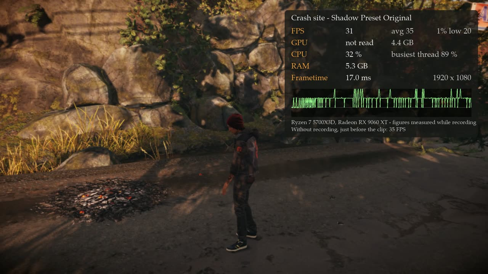
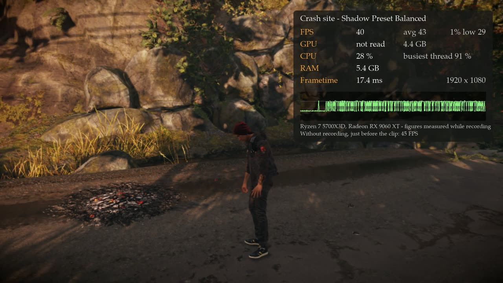
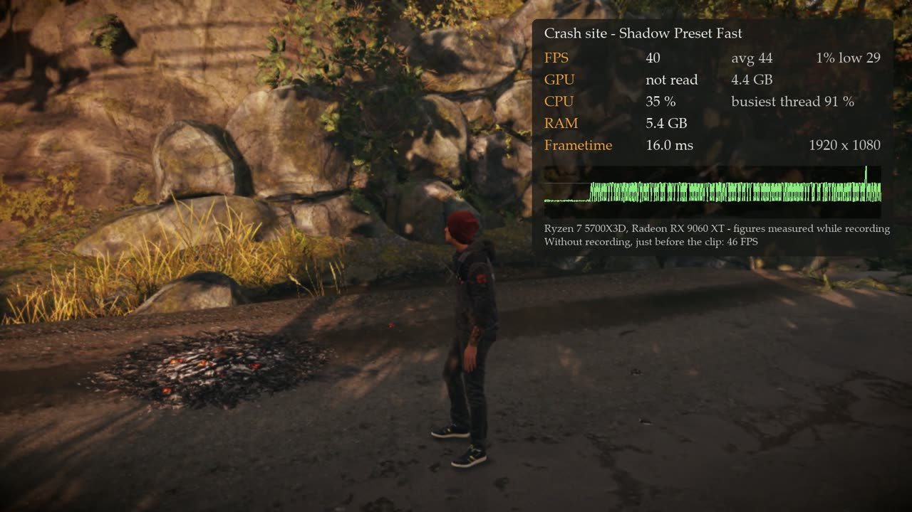
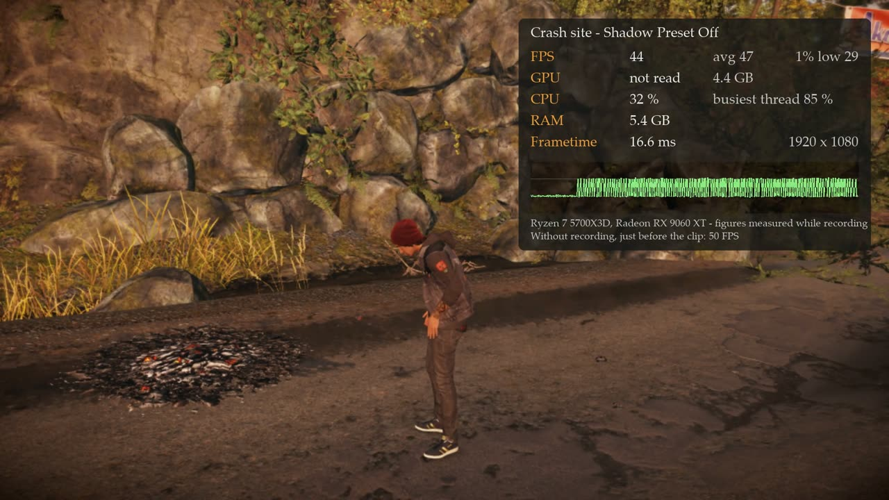
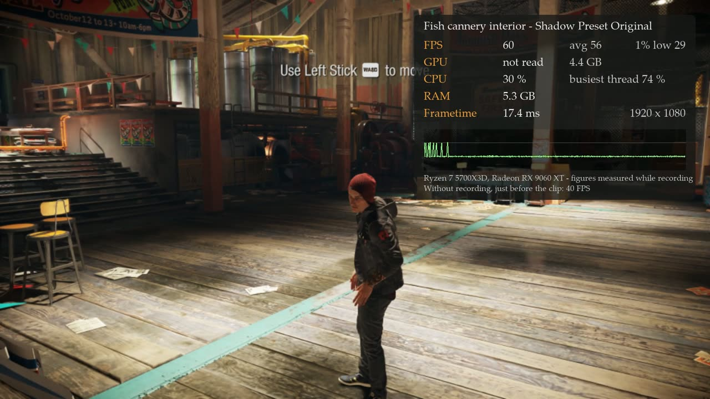
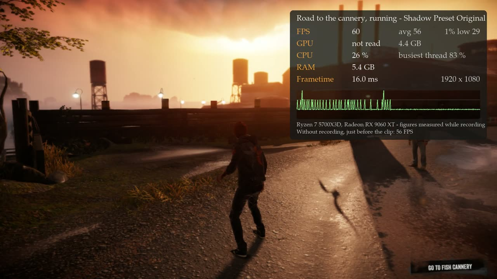
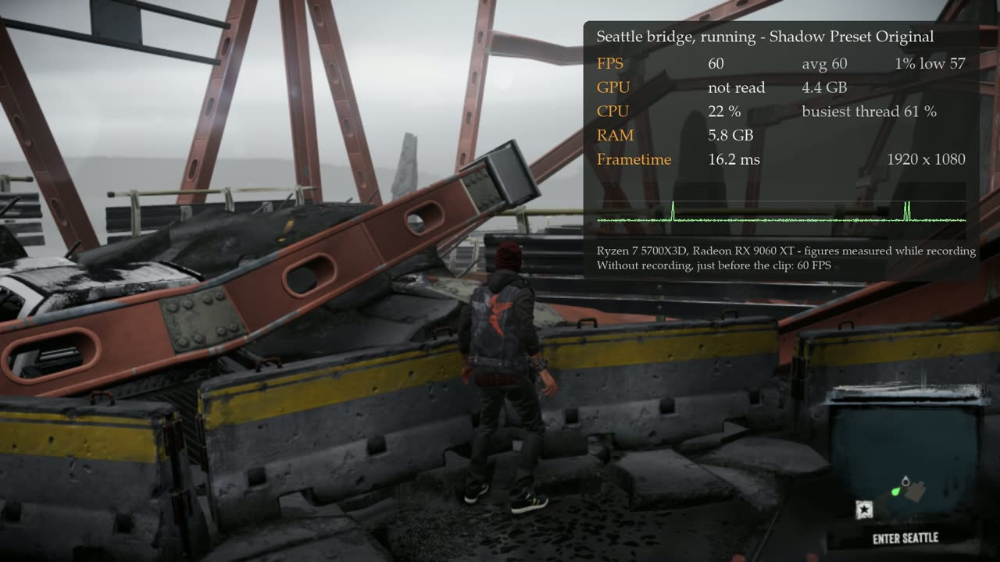

# inFAMOUS Second Son on PC (i3-pc): unofficial build scripts, notes and how to play

This repository holds the wrapper around a game-specific build of the
[shadPS4](https://github.com/shadps4-emu/shadPS4) emulator that runs **inFAMOUS Second Son**
(PS4, CUSA00004, v1.07) on Windows: build and install scripts, the launcher and settings
scripts, test scripts and the benchmark and investigation notes. The emulator source with the
changes for this game is in the `runtime` branch of this repository.

It is an unofficial, game-specific build derived from shadPS4. It is not affiliated with or
endorsed by Sony Interactive Entertainment, Sucker Punch Productions or the shadPS4 project.

## How this works

This is not a rewrite of the game and not a native port in the strict sense. The game's own
PS4 program, read from your copy and left as it is on disk, runs inside a **custom build of
the shadPS4 emulator** made for this one game:

- **The runtime** (the `runtime` folder, a git submodule) is the source of
  [shadPS4](https://github.com/shadps4-emu/shadPS4), GPL-2.0-or-later, with this project's
  commits on top of an upstream commit. Nothing here is sent upstream, and the upstream project
  has no part in it.
- **This repository** (the wrapper) holds everything around the runtime: build scripts, the
  files that sit beside the finished program (launcher, settings and key scripts, default key
  bindings, the player's guide), the test and benchmark scripts and the notes.
- **The game is not included.** You need your own copy of the game, dumped from your own
  console; the program only reads it.

What the runtime changes against upstream, in short:

- Fixes that this game needs and that are switched on for its serial only: results of compute
  shaders are copied back to the game's memory where the game reads them, garbage arguments of
  indirect draws are caught, the game's large geometry heaps are uploaded ahead of their first
  use, and repeated per-draw work is cut down (see `docs/BENCHMARK.md`).
- A start screen, and the PC settings as extra sections at the end of the game's own Options
  screen (graphics, shadow and effects presets, key rebinding, language, achievements),
  first-run settings.
- Keyboard and mouse as a full input device, with key caps instead of controller pictures in
  the game's button prompts.
- Its own program name, window title and settings folder, so that it does not touch an
  installed shadPS4.
- Test aids: scripted input, screenshots and capture, per-pass and per-draw statistics, a
  sampling profiler.

## Frame rates

Measured on one PC (Ryzen 7 5700X3D, Radeon RX 9060 XT, 1080p, 60 Hz), 2026-10-13, 24 seconds a
place while recording. Details, method and older figures are in `docs/BENCHMARK.md`.

| Place | Shadow Preset | Average | 1 % low |
|---|---|---|---|
| Crash site (heaviest early scene) | Original | 37.8 FPS | 20.0 |
| Crash site | Balanced | 45.2 FPS | 29.1 |
| Crash site | Fast | 45.9 FPS | 29.2 |
| Crash site | Off | 48.9 FPS | 29.1 |
| Fish cannery interior | Original | 48.0 FPS | 29.2 |
| Road to the cannery, running | Original | 52.5 FPS | 29.2 |
| Seattle, wrecked bridge, looking along it | Original | 59.9 FPS | 56.7 |
| Seattle, same spot, looking at the city | any | about 26 FPS | not measured |

One frame of each benchmark clip, with the readout that was measured while it was recorded:

The pictures show the author's own copy of the game running in this build. The game, its
art and its characters belong to their owners; the pictures are here only to show the
measurements.

The runtime installed since then holds the fix for the crash in long fire fights, which
costs frame rate where fire and particles are on screen: the crash site now runs at 41.6 FPS
without recording (about 50 before the fix). The city view is the other limit: about 9,100
draws a frame, most of them for the distant skyline, and one CPU thread has to prepare them all.

**Work in progress.** Played and checked from the keyboard from the tutorial to the first boss
fight. See [Known problems](#known-problems).

## How to play, step by step

### 1. What you need

1. Your own legally obtained copy of inFAMOUS Second Son for PS4 (European release,
   CUSA00004, updated to v1.07), dumped from your own console to a folder on your PC. The folder
   holds `eboot.bin`, `sce_module`, `sce_sys` and `art`. Nothing from the game is in this
   repository, and it cannot be downloaded here.
2. A Windows 10 or 11 PC, 64-bit.
3. A graphics card with Vulkan 1.3 and current drivers.
4. About 6 GB of free memory while the game runs, and room for the game folder.

What the game needs most is a fast single CPU core; the graphics card matters little. Measured
on a Ryzen 7 5700X3D with a Radeon RX 9060 XT: 60 FPS in light scenes and on the road, 40 to 50
FPS in the heaviest scene (see `docs/BENCHMARK.md`). A slower CPU gives proportionally less.
Those numbers are from one PC; nothing else has been measured.

### 2. Get the program

No ready-made program is published. You build it once from source:

1. Install Visual Studio 2022 with "Desktop development with C++", CMake, Git and clang 23
   (LLVM for Windows).
2. Get the source with its submodules:
   `git clone --recursive https://github.com/SotC-project/i3-pc.git`
3. Open `build-lto.bat` in a text editor. Two lines hold paths from the author's PC: the
   `vcvars64.bat` of Visual Studio and the `bin` folder of clang. Change both to yours.
4. Run `build-lto.bat`. The first build takes a long time.
5. Copy `runtime\Build\x64-Clang-Release\shadps4.exe` into the `dist` folder and rename it
   `inFAMOUS Second Son.exe`.

The `dist` folder is now the game's program folder. You can move it anywhere.

### 3. Tell the program where the game is

1. In the `dist` folder create a text file named `game_path.txt`.
2. Write one line in it: the full path of the game's `eboot.bin`, for example
   `D:\Games\CUSA00004\eboot.bin`.

The game folder is only read, never changed.

### 4. First start

1. Run `Install.bat` once if you want Desktop and Start menu shortcuts.
2. Start `Play.bat` (or the shortcut).
3. On the very first start the program picks settings for your PC (borderless fullscreen at
   your screen size, a frame rate cap, upscaling) and shows a few opening lines. You can change
   everything later. Settings that already exist are never replaced.
4. The game loads for about 40 seconds. Then the start screen appears.

### 5. The start screen

| Line | What it does |
|---|---|
| Continue | Carries on from your last save (shown once a save exists) |
| New Game | Starts the game. If a save exists, it loads first and the game's own Options screen then opens on "New Game" |
| Load Game | Your last save loads first; the game's own Options screen then opens on "Load Game" |
| Options | Graphics, Controls, Gameplay, Sound, Interface |
| Achievements | The game's trophies: locked, or the date unlocked |
| Quit | Closes the game (asks once more) |

Move with the arrow keys or W and S, or the d-pad or left stick. Confirm with Enter or Cross.
Go back with Esc or Circle. The mouse works too.

### 6. Controls

Keyboard and mouse (the defaults; change them in the Controls section at the end of the game's
Options screen):

| Action | Key |
|---|---|
| Move | W A S D |
| Camera | Mouse |
| Main attack | Left mouse button |
| Aim / zoom | Right mouse button |
| Heavy attack | Middle mouse button or Q |
| Special power | E |
| Jump | Space |
| Dash | Left Shift or Left Ctrl |
| Melee | F |
| Karmic actions | R |
| Interact, drain (touchpad press) | T or Tab |
| Touchpad swipe | I up, K down, J left, L right |
| Touchpad with both thumbs (for example Move Car) | Hold U |
| Hold the controller sideways (spray can) | Hold G, then aim with the mouse and spray with the left button |
| Shake the controller | Hold H |
| D-pad | Arrow keys or 1 2 3 4 |
| Pause | Esc |

Controller: an Xbox, DualShock 4 or DualSense controller works as on the console, alongside
the keyboard. Options (Start on an Xbox controller) pauses.

The button pictures in the game follow what you use: key caps on keyboard and mouse, the
PlayStation pictures once you touch a controller.

Other keys: F11 fullscreen, F10 frame rate counter, F12 screenshot, F7 frees or captures the
mouse.

### 7. Options

Esc (Options on a controller) during play opens the game's own pause screen, as on the
console: in the village its Options screen, in Seattle the map, where Triangle (Tab) opens
"Options and Saves".

The settings this program adds are the last sections of that Options screen. Go down past the
game's last line (Video > HDR Rendering) and the list goes on:

- **Display, Image, Effects, Frame Rate, Shadows**: this program's graphics settings.
- **Controls**: the keyboard and mouse bindings. Confirm a line, then press the key or mouse
  button to use.
- **Language**.
- **Achievements**: the trophy list.
- **Exit**: Return to Main Menu and Quit. Both ask once more. Return to Main Menu loses the
  progress since the last checkpoint and loads the game again (about 40 seconds), because the
  game has no main menu of its own to go back to.

Up from the first of these lines goes back to the game's own lines; Back closes the screen.
There is no separate settings window.

### 8. Graphics settings

The Display to Shadows sections at the end of the game's Options screen. Start with these and
change one thing at a time:

| Your PC | Shadow Preset | Frame Rate Cap |
|---|---|---|
| Fast recent CPU (like the test PC or better) | Balanced | 60 |
| Mid-range CPU | Fast | 60 |
| Older or laptop CPU | Off | 30 or 60 |

- **Shadow Preset**: Original is the game's picture. Balanced and Fast leave small objects
  out of the sun's shadows and draw lamp shadows less often (Fast: not at all); the sun's
  shadows themselves are drawn every frame in every preset, since a kept shadow map flashed
  dark while the camera moved. Off removes shadows and saves the most.
- **Frame Rate Cap** is the game's frame clock. At 60 a frame that needs 18 ms is shown after
  33 ms; at 120 or 144 it is shown after 25 ms or less, which is smoother in heavy scenes
  whatever your display's rate (measured at the crash site: frames over 34 ms fell from 226 to
  10). The average hardly changes.
- **Upscaling (FSR)** scales the game's 1080p picture to your screen. It costs almost nothing.
- **Effects Preset** changes the look more than the speed.
- Frame Rate Cap and VSync take effect the next time the game starts. Everything else applies
  at once.

### 9. Language

The game follows the console language of its settings, and the screens this program adds
(start screen, the added Options sections, achievements) follow it too. Change it under
Options > Language, near the end of the game's Options screen; it applies the next time the
game starts. English, French,
Spanish, German, Italian, Dutch, Portuguese, Russian, Finnish, Swedish, Danish, Norwegian,
Polish and Turkish are there, the languages this release of the game ships. The texts of this
program's own screens are machine translations that no native speaker has checked; where one is
missing, English is shown.

### 10. Saving

- The game saves by itself at checkpoints (a small icon shows in a corner).
- To save by hand: "Save Game", the first line of the game's Options screen (in Seattle:
  "Options and Saves" on the map).
- Saves are in `dist\user\home\1000\savedata\CUSA00004`. Copy that folder to back them up.

### Known problems

- The frame rate is below 60 in the heaviest scenes on every PC tested so far (one).
- In Seattle the frame rate depends on where the camera points: 60 FPS looking along the
  wrecked bridge, about 26 FPS looking at the city from the same spot (23 before the runtime
  of 2026-10-13). The Shadow Preset does not change that; the distant skyline is the cost
  (see `docs/BENCHMARK.md`).
- A few freezes of about a quarter of a second in the first minute after a save has loaded (one
  of 2 to 3 seconds there is gone with the copy-back changes of 2026-10-13).
- On the road to Seattle the game loads its city geometry in one step: a pause of about half a
  second there (it was 2 to 3 seconds before runtime f3481a25).
- Earlier builds crashed after a few minutes of sustained firing in the first boss arena, and
  on the wrecked bridge in Seattle. The game takes the next slot of a particle array from a
  counter the graphics card computes; when that result came back late the counter held
  garbage, and a bounds check in the game let a negative index through. The runtime of
  2026-10-14 makes that one check unsigned as the game loads (one byte; the game files are
  not changed), so such an index is clamped like any other overflow. Since then: 9 of 9
  three-minute test runs alive on the bridge and in fire fights, 4 of them with the results
  made late on purpose. Some particles can still be missing for a frame on the bridge.
- New Game and Load Game on the start screen open the game's Options screen for you once the
  last save has loaded. If that save opens in a cutscene, the game shows "Paused" instead:
  continue the cutscene, then open Options yourself (in Seattle: Options, then Triangle / R).
- Trophies are listed as "Trophy 1" to "Trophy 48": their names are not readable from the game
  data.
- Played up to the first boss fight by hand. Beyond it, tested from saves edited for testing:
  the mission after the boss starts in the longhouse, and the first open-world mission in
  Seattle ("Find Core Relays") plays with running, climbing, jumping and the smoke dash.
- Moving into parts of Seattle the game has not shown before stutters while their shaders
  are compiled (pauses of 0.1 to 1.7 s); they are stored, and later sessions stutter less
  (in one walk repeated four times: 128, 45, 15 and 18 pauses). The first session after
  installing the runtime of 2026-10-14 compiles everything again, once.
- The picture is always rendered at 1080p; higher output sizes are upscaled.
- `docs/NOTES.txt` lists what has been checked and what is open.

### Reporting a problem

Open an issue in this repository. Say where in the game it happened and what you did, name your
CPU and graphics card, and attach `dist\user\log\shad_log.txt` from that run. Do not attach
game files or saves.

## What is not here

No game files, no PS4 system modules, no keys, no saves, no shader caches, no videos, and no
icons, fonts or textures from the game. The only pictures of the game are the seven benchmark
frames under Frame rates. The program icon is not included either:
`dist/Install.ps1` uses `dist/game.ico` if you put one there. `dist/Keys.ps1` redraws the button
icons as key caps on top of the game's own icon sheet, which you have to dump from your copy
first (`dist/glyphs/atlas_original.raw`); without it the key bindings still work and the icons
stay as they are.

## Layout

| Path | What |
|---|---|
| `runtime/` | The emulator source (git submodule, branch `runtime` of this repository): shadPS4 plus the changes for this game |
| `build.bat`, `build-lto.bat` | Build the runtime with clang (test build / optimized build) |
| `install.sh` | Copy the test build to `bin/i3.exe` |
| `dist/` | What sits beside the finished program: `Play.bat`, `Settings`, `Keys`, `Install`, `README.txt`, default key bindings |
| `*.sh` | Headless test, benchmark, frame-time and scripted-play runs (they hold paths from the author's PC) |
| `tools/` | Profiler summary, SPIR-V helpers, one-off source patch scripts |
| `docs/` | Benchmark, threading study and play/stability notes |

## Licence

The runtime is a derivative of shadPS4 and is licensed under GPL-2.0-or-later, as are the
scripts in this repository. See `LICENSE`.
